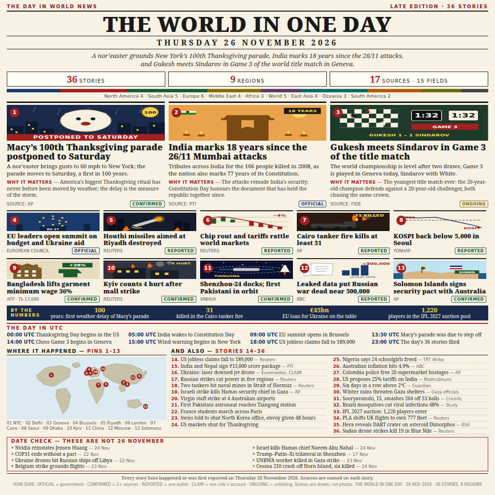

[](https://make.fun/c/news-image-20261126)
[](https://make.fun/c/news-image-20261126)
[](https://make.fun/c/news-image-20261126)

# The World in One Day — v8

One image summing up the world's news of **Thursday 26 November 2026**,
for the [make.fun competition](https://make.fun/c/news-image-20261126).

36 stories, 9 regions: 3 lead stories and 10 cards with drawn scenes, plus
23 more in a numbered list. Every lead carries a **WHY IT MATTERS** line,
so a reader who missed the day can tell what happened — and why it mattered
— from the image alone. A world map pins stories 1–13, a UTC timeline walks
the day, a numbers strip leads with the day's figures, and a DATE CHECK box
keeps out the stories that are *not* 26 November.



## The 3 leads

1. **Macy's 100th Thanksgiving parade postponed to Saturday** — a nor'easter
   brings gusts to 60 mph to New York; the first weather delay in the
   parade's 100 years. (AP, CONFIRMED)
2. **India marks 18 years since the 26/11 Mumbai attacks** — tributes for
   the 166 people killed in 2008, as the nation also marks 77 years of its
   Constitution. (PTI, OFFICIAL)
3. **Gukesh meets Sindarov in Game 3 of the title match** — the world
   championship is level after two draws; Game 3 is played in Geneva,
   Sindarov with White. (FIDE, ONGOING)

## How it is made

`page.html` is the newspaper page (HTML + inline SVG scenes, no external
resources). `build.mjs` renders it to `entry.png` at 1024×1024 with headless
Chromium. `main.ts` (Node 22, standard library only) is the entrypoint: in
the grading sandbox, where there is no Chromium and no network, it copies
the shipped `entry.png` to `/output/entry.png` and verifies the copy by
SHA-256, so both runs write the same bytes.

```sh
node build.mjs   # renders entry.png (needs Chromium)
node main.ts     # copies entry.png to /output/entry.png, verifies SHA-256
```

`entry.png` — 359,339 bytes, 1024×1024, SHA-256
`32ec66f03f369f46175aa2db96dd873bcd3dfce3de6aeea55a1d013c72bd44e6`
(three independent renders produce identical bytes).

## Stories (36)

**Leads 1–3:** Macy's parade postponed · India 26/11 18 years ·
Gukesh–Sindarov Game 3.

**Cards 4–13:** EU summit on budget and Ukraine aid · Houthi missiles aimed
at Riyadh destroyed · Chip rout and tariffs rattle world markets · Cairo
tanker fire kills at least 31 · KOSPI back below 5,000 in Seoul ·
Bangladesh lifts garment minimum wage 36% · Kyiv counts 4 hurt after mall
strike · Shenzhou-24 docks, first Pakistani in orbit · Leaked data put
Russian war dead near 500,000 · Solomon Islands signs security pact with
Australia.

**List 14–36:** US jobless claims 189,000 · India–Nepal ₹15,000 crore
package · Ukraine laser downed jet drone (CLAIM) · Russian strikes cut power
in five regions · Two tankers hit naval mines in Hormuz · Israeli strike
kills Hamas security chief in Gaza · Virgin staff strike at 4 Australian
airports · First Pakistani astronaut reaches Tiangong · France students march
· Swiss told to shut North Korea office · US markets shut for Thanksgiving ·
Nigeria: 24 schoolgirls freed · Australian inflation 4.9% · Colombia police
free 20 supermarket hostages · US proposes 25% tariffs on India · Six days
in a row above 2°C · Winter rains threaten Gaza shelters · Sooryavanshi, 15,
smashes 204 off 53 balls · Brazil mosquitoes cut viral infections 68% ·
IPL 2027 auction: 1,220 players enter · PLA shifts UK flights to own 777
fleet · Hera reveals DART crater on Dimorphos · Sudan drone strikes kill 19
in Blue Nile.

**DATE CHECK — not 26 November:** Nvidia reinstates Jensen Huang (24 Nov) ·
COP31 ends without a pact (22 Nov) · Ukraine drones hit Russian ships off
Libya (22 Nov) · Belgium strike grounds flights (23 Nov) · Israel kills
Hamas chief Naeem Abu Nahal (24 Nov) · Trump–Putin–Xi trilateral in
Shenzhen (17 Nov) · UNRWA worker killed in Gaza strike (23 Nov) · Cessna
210 crash off Horn Island, six killed (24 Nov).

## License

MIT — see [LICENSE](LICENSE).
